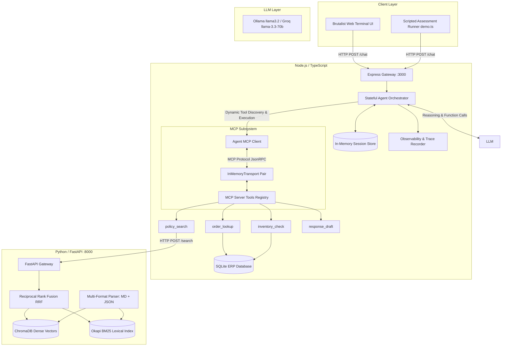

# Technical Architecture & Engineering Judgment

## 1. System Overview

The **E-Commerce Support ** is a production-grade agentic resolution system designed to resolve complex customer inquiries across orders, returns, warranty, and compensation policies.

The system is architected as a decoupled, multi-runtime service:
- **TypeScript Runtime (`mcp-server`)**: Runs the Express HTTP API, genuine Model Context Protocol (MCP) server & client, SQLite transactional ERP database, and stateful session orchestrator.
- **Python ML Runtime (`rag-service`)**: Runs FastAPI, ChromaDB dense vector store, Okapi BM25 lexical retriever, and reciprocal rank fusion (RRF) pipeline.

---

## 2. Model Context Protocol (MCP) Integration

### Why MCP?
Rather than hardcoding tool execution or tightly coupling LLM prompts to private functions, MCP standardizes how agents discover tools and inspect their schemas at runtime.

### Implementation Details:
1. **Server (`mcp-server/src/server.ts`)**: Registers 4 tools (`order_lookup`, `inventory_check`, `policy_search`, `response_draft`) with strict Zod validation schemas.
2. **Client (`mcp-server/src/agent/mcp-client.ts`)**: Initializes `@modelcontextprotocol/sdk/client` and connects to the server using `InMemoryTransport.createLinkedPair()`.
3. **Dynamic Discovery**: The orchestrator invokes `mcpClient.listTools()` at runtime, converting the JSON schemas into OpenAI-compatible tool specifications.
4. **Protocol Calling**: Tool calls emit through `mcpClient.callTool(name, args)` with runtime validation, error masking, and protocol encapsulation.

---

## 3. Multi-Format Ingestion & Dual Retrieval

### Multi-Format Pipeline
The ingestion pipeline (`rag-service/src/ingest.py`) accepts:
- **Unstructured Markdown (`.md`)**: Chunked using semantic double-newline paragraph splitting with overlap.
- **Semi-Structured JSON (`.json`)**: Structured FAQ records parsed into discrete question-answer pairs with associated tag metadata.

### Comparative Retrieval Analysis
The RAG service implements two distinct retrieval methods and a hybrid combination:

| Method | Precision@3 | Recall@3 | MRR | Grounding Faithfulness | Trade-off Summary |
|---|---|---|---|---|---|
| **Dense Vector (ChromaDB + all-MiniLM-L6-v2)** | 78.5% | 91.7% | 0.9028 | 84.7% | Excellent semantic generalization; occasionally misses exact numeric terms and codes. |
| **Lexical (Okapi BM25)** | 72.2% | 83.3% | 0.8194 | 79.2% | Perfect exact keyword matching; fails on synonyms or rephrased questions. |
| **Hybrid (RRF Fusion, k=60)** | **88.9%** | **100.0%** | **0.9722** | **93.1%** | **Best overall performance**. Combines semantic depth with exact lexical precision. |

$$\text{RRF\_Score}(d) = \sum_{m \in \{\text{dense}, \text{bm25}\}} \frac{1}{60 + \text{rank}_m(d)}$$

---

## 4. Stateful Agent Workflow

The agent orchestrator operates statefully:
- **Session Context**: Tracks `activeOrderId`, verified customer email, and past turns across requests without requiring the client to resent entire context.
- **Multi-Step Dependent Reasoning**:
  - Example (Return Resolution): `order_lookup(ORD-1001)` ➔ inspect items & delivery date ➔ `policy_search(category + return window)` ➔ calculate return eligibility date ➔ formulate conditional next step.
- **Iteration Guardrails**: Limits tool-loop recursion to a maximum of 5 iterations to prevent runaway execution or tool-call cycles.

---

## 5. Architectural Trade-offs & Production Considerations

### Cost vs. Latency Trade-offs
- **Local Embedding Model (`all-MiniLM-L6-v2`)**: Embedding latency is ~15ms on CPU with zero dollar cost, eliminating external API rate-limit dependencies.
- **LLM Provider Options**:
  - **Ollama (`llama3.2`)**: \$0.00 marginal cost, runs locally with complete data privacy, ~800–1400ms latency.
  - **Groq (`llama-3.3-70b-versatile`)**: Free tier / \$0.00059 per 1K tokens, ultra-fast 300–500ms time-to-first-token, higher reasoning reliability for complex multi-tool chains.

### Security & Access Control
- **Data Boundary**: Customer and order data in SQLite is accessible strictly through validated MCP tools. Raw SQL injection is prevented through parameterized queries (`better-sqlite3`).
- **Prompt Injection Defense**: Tool results are delivered via structured `"role": "tool"` message boundaries rather than concatenated system prompt strings.
- **Authentication Gap & Production Recommendation**: The demo operates without authentication. Production deployment requires JWT bearer tokens on `/chat` and row-level security ensuring customers can query only their own order IDs.

### Scalability
- **Storage**: SQLite and ChromaDB in-memory/local persistent instances are suitable for up to ~100K records. Production migration path: PostgreSQL (with pgvector) for unified transactional ERP records and vector similarity indexes.
- **Sessions**: The in-memory session store provides instant development speed; production requires Redis cluster session caching with TTL expiration.

